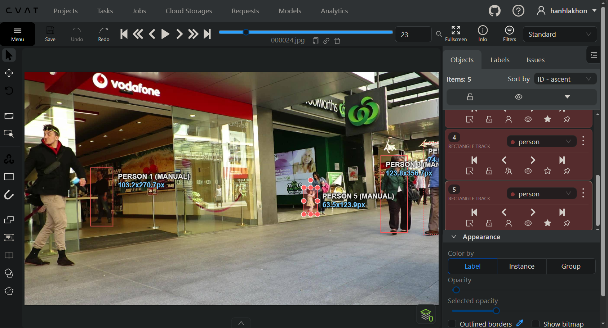
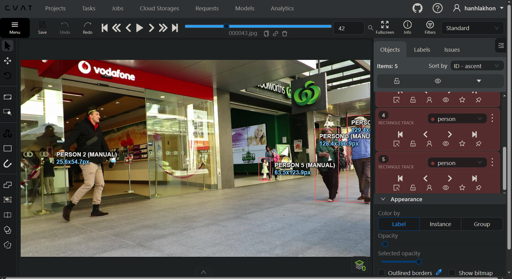
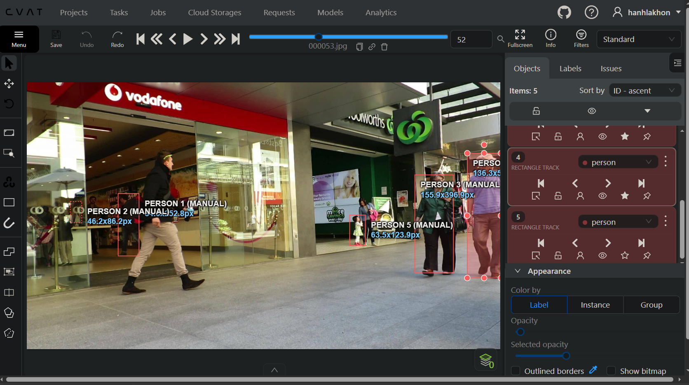

# Báo cáo cá nhân: 2A202603221 - HaKhanh

Đoạn video: MOT17-09, 150 frame (frame 0 đến 149 trên CVAT, tương ứng frame 1 đến 150 trong MOT 1.1), nguồn MOT17, MOTChallenge (Milan et al., 2016), giấy phép CC BY-NC-SA 3.0.

## 0. Thông tin học viên

- Họ tên: HaKhanh
- MSSV: 2A202603221
- Mã đề (A/B/C): C (xác nhận qua `python src/setup_local_lab.py --mssv 2A202603221 --assignment-only`, tên task `DAY05-MOT17-09-C-2A202603221`)
- Email: hakhanh699669@gmail.com
- Link repository: https://github.com/Ngunhcho7654/K5-L2-DAY05-HaKhanh-2A202603221-MOTTracking
- Giờ bắt đầu: 16:57 GMT+7 (theo dấu thời gian tạo job `2026-11-13 09:57:58 UTC` trong `annotations.xml`)
- Giờ kết thúc: 18:43 GMT+7 (theo dấu thời gian xuất `annotations.xml` lúc `2026-11-13 11:43:00 UTC`; ảnh chụp màn hình lưu lúc 19:11-19:13 GMT+7)

## 1. Xem trước đoạn video (CP0)

Đề C giao theo dõi 5 người có mã GT gốc `[1, 7, 20, 22, 23]` trong `src/lab_variants.json`.

| Mã | Frame xuất hiện | Frame cuối thấy được | Rẽ / dừng / đổi tốc độ ở frame | Bị che ở frame | Ghi chú |
|---|---:|---:|---|---|---|
| P1 (GT 1) | 0 | 149 | Đi chậm lại và xoay hướng ra cửa khoảng frame 84-115 | 27-51 (che một phần), 42-43 (khuất hẳn) | Nam áo len đen trong cửa hàng Vodafone |
| P2 (GT 7) | 29 | 149 | Tiến ra khỏi vùng quầy kính từ frame 64, đi thẳng ra cửa đến frame 149 | 29-73 (bị quầy và cửa kính che nửa thân dưới) | Nữ đi sau P1 trong cửa hàng Vodafone |
| P3 (GT 20) | 0 | 149 | Đi chéo từ phải sang trái và tiến gần camera suốt đoạn | 0-39 (bị cắt một phần ở mép phải khung hình) | Nam áo xanh dương, đội mũ trắng |
| P4 (GT 22) | 0 | 149 | Đứng và di chuyển chậm cạnh bé gái trước cửa Woolworths | 105 trở đi (bị GT 19 và GT 20 đi ngang qua che) | Nữ mang túi hồng; trong file xuất đã gán nhầm sang GT 19 |
| P5 (GT 23) | 0 | 149 | Đi nhanh từ trái sang phải qua cửa Vodafone rồi rẽ vào hành lang | 113 trở đi (bị GT 19 và GT 20 che khuất phần lớn thân) | Nam áo khoác đen, quần kaki; trong file xuất đã gán nhầm sang GT 21 |

## 2. Keyframe và thời gian (CP1, CP4)

Số liệu keyframe lấy từ kết quả chạy `src/check_submission.py` trên `HaKhanh_cvat_video.zip` và `HaKhanh_mot.zip`. Trong file xuất thực tế, ba track đầu khớp P1, P2, P3 của đề C, còn hai track còn lại bám theo GT 19 (nữ áo xanh lục) và GT 21 (bé gái trước cửa Woolworths). Metadata trong `annotations.xml` chỉ ghi thời điểm tạo job (16:57 GMT+7) và cập nhật lần cuối (18:41 GMT+7), không ghi thời gian riêng cho từng người nên bảng giữ tổng thời gian là 104 phút.

| Mã (Track CVAT / MOT) | Số keyframe | Keyframe ở frame | Số frame có mặt | Keyframe / 100 frame | Thời gian (phút) | Chỗ khó |
|---|---:|---|---:|---:|---:|---|
| P1 (Track 0 / MOT 1) | 39 | 0, 4, 16, 17, 19, 25, 27, 44, 45, 46, 47, 48, 49, 50, 51, 52, 53, 54, 55, 62, 64, 67, 69, 72, 84, 85, 86, 87, 88, 99, 100, 112, 114, 115, 116, 120, 133, 145, 149 | 148 | 26,4 | Chưa ghi riêng | Đoạn bị người áo khoác đen đi ngang che (frame 27-55) |
| P2 (Track 1 / MOT 5) | 85 | 29, 30, 31, 32, 33, 34, 35, 36, 37, 38, 39, 40, 41, 42, 43, 44, 45, 46, 47, 48, 49, 50, 51, 52, 53, 54, 55, 56, 57, 58, 59, 60, 61, 63, 64, 65, 66, 67, 68, 69, 70, 71, 72, 73, 74, 75, 78, 79, 80, 81, 82, 83, 85, 86, 87, 88, 89, 90, 91, 92, 99, 100, 102, 104, 111, 114, 119, 120, 122, 123, 125, 126, 127, 132, 134, 135, 136, 137, 138, 140, 141, 144, 145, 148, 149 | 121 | 70,2 | Chưa ghi riêng | Khuất nửa dưới sau quầy và cửa kính (frame 29-73), kích thước hộp tăng mạnh ở frame 64 |
| GT 19 (Track 2 / MOT 2) | 76 | 0, 4, 6, 8, 9, 15, 19, 20, 21, 22, 23, 24, 32, 34, 36, 39, 40, 44, 46, 48, 49, 50, 52, 54, 55, 57, 58, 59, 60, 62, 64, 66, 69, 71, 80, 82, 84, 85, 87, 89, 91, 92, 93, 95, 96, 98, 100, 101, 103, 105, 108, 110, 111, 113, 115, 118, 120, 122, 123, 124, 125, 127, 128, 131, 132, 133, 134, 135, 137, 139, 141, 142, 143, 144, 148, 149 | 150 | 50,7 | Chưa ghi riêng | Tiến nhanh về phía camera nên chiều cao hộp tăng từ 326 px lên 822 px |
| P3 (Track 3 / MOT 3) | 94 | 0, 3, 5, 6, 7, 8, 9, 10, 11, 12, 13, 14, 15, 16, 17, 18, 19, 20, 21, 22, 24, 25, 27, 29, 31, 32, 40, 41, 47, 48, 52, 55, 56, 58, 62, 63, 65, 66, 67, 68, 72, 74, 77, 78, 81, 82, 90, 92, 93, 95, 96, 97, 98, 99, 100, 101, 102, 105, 110, 111, 112, 113, 114, 115, 116, 117, 118, 119, 120, 121, 122, 123, 127, 128, 129, 130, 131, 132, 133, 134, 135, 136, 137, 138, 139, 140, 141, 142, 143, 144, 145, 146, 147, 148 | 150 | 62,7 | Chưa ghi riêng | Mới vào từ mép phải (frame 0-39) và phóng to nhanh từ 187 px lên 924 px |
| GT 21 (Track 4 / MOT 4) | 28 | 0, 2, 4, 5, 8, 10, 11, 13, 15, 17, 18, 19, 20, 21, 22, 23, 25, 27, 32, 36, 41, 44, 106, 135, 138, 140, 142, 145 | 125 | 22,4 | Chưa ghi riêng | Đứng trước Woolworths rồi bị che khuất hoàn toàn ở frame 112-134 và 148-149 |
| Tổng | 322 | | 694 | 46,4 | 104 | |

Keyframe / 100 frame của cả bài = 322 ÷ 694 × 100 = 46,4.

Số keyframe nhiều nhất nằm ở P3 (CVAT Track 3) với 94 keyframe, còn mật độ cao nhất nằm ở P2 (CVAT Track 1) với 70,2 keyframe / 100 frame. Nguyên nhân là P3 vừa mới bước vào từ mép phải khung hình vừa đi chéo lại gần camera nên kích thước tăng gần 5 lần, đồng thời người gán đã chỉnh tay liên tiếp qua từng frame ở đoạn 5-22 và 110-148; tương tự, P2 bị chỉnh tay gần như từng frame trong đoạn 29-75 khi đi qua vùng che khuất sau cửa kính.

## 3. Đoạn bị che (CP2)

Người bị che: `P1` (`GT 1`, `CVAT Track 0`, `MOT Track 1`).

| Mốc | Frame |
|---|---:|
| Bắt đầu bị che một phần (bật `occluded`) | 27 |
| Mất hẳn (bật `outside`) | 42 |
| Hiện lại (tắt `outside`) | 44 |
| Thấy rõ trở lại (tắt `occluded`) | 52 |

- Thời gian khuất hẳn: 2 frame (frame 42 và 43) = 0,07 giây ở tốc độ 30 fps.
- Quyết định: giữ cùng ID (`Track 0` trên CVAT, `Track 1` trong MOT 1.1).
- Lý do: Đoạn khuất hẳn chỉ dài 2 frame, ngắn hơn nhiều so với ngưỡng 60 frame (2 giây) của lớp. Khi hiện lại ở frame 44, người đó vẫn có ngoại hình khớp với đoạn trước (áo len dài tay màu đen, quần jean, đeo kính, đi bên trong cửa hàng Vodafone). Vị trí và hướng bước sang phải nối tiếp liên tục ngay sau lưng người đàn ông áo khoác đen đi ngang qua.

Ảnh chụp màn hình (nguồn ảnh: MOT17, MOTChallenge (Milan et al., 2016)):





## 4. Tự review ID (CP3)

Kết quả đối chiếu dữ liệu thực tế trong `HaKhanh_cvat_video.zip`, `HaKhanh_mot.zip` với bảng nhận diện Đề C và các frame ảnh `.lab-local/mot17-09/`:

| Frame | Mã người | Loại lỗi | Mô tả một câu | Phát hiện ở lượt | Đã sửa? |
|---:|---|---|---|---|---|
| 0 | Track 2 (MOT 2) | `false_track` | Track này gán cho người phụ nữ áo xanh lục đậm (GT 19 của đề A) trong khi đề C yêu cầu GT 22 và GT 23. | Lượt 2 | Chưa |
| 0 | Track 4 (MOT 4) | `false_track` | Track này gán cho bé gái trước cửa Woolworths (GT 21 của đề A) trong khi đề C yêu cầu GT 22 và GT 23. | Lượt 2 | Chưa |
| 29-63 | P2 (Track 1 / MOT 5) | `flag` | Box bị co theo phần đầu và vai lộ ra sau cửa kính (cao 31-127 px) khiến chiều cao nhảy > 30% tại các frame 33, 44, 59 và 64. | Lượt 1 | Chưa |
| 44-48 | P1 (Track 0 / MOT 1) | `flag` | Khi tắt outside sau đoạn che, chiều rộng box bị co về 70,4-84,9 px theo phần thân lộ ra, mất kích thước amodal box 103 px trước đó. | Lượt 1 | Chưa |
| 27 | P1 (Track 0 / MOT 1) | `flag` | Cờ occluded được bật ở frame 27 trong khi trên ảnh 000028.jpg người đàn ông áo đen chưa chắn trước P1. | Lượt 1 | Chưa |

Tổng hợp số lỗi theo loại:

| `id_switch` | `fragmentation` | `lost` | `merge` | `false_track` | `drift` | `flag` |
|---:|---:|---:|---:|---:|---:|---:|
| 0 | 0 | 0 | 0 | 2 | 0 | 3 |

Lỗi `false_track` do gán nhầm hai người từ đề A sang đề C dễ phát hiện ở lượt 2 hơn lượt 1. Ở lượt 1, người review chỉ đi dọc một track nên vẫn thấy box bám sát người đó và không nhận ra sai đối tượng của đề; sang lượt 2, khi đặt cả 5 box lên cùng khung hình và so với bảng nhận diện P1-P5 của đề C, sự sai lệch đối tượng lộ ra ngay. Các lỗi trên chưa được sửa vì hai file zip nộp hiện tại vẫn là bản xuất lúc 18:43-18:44 GMT+7 trước khi rà soát lại với bảng đề C.

## 5. File xuất và kết quả tự kiểm (CP4)

| Kiểm tra | Kết quả |
|---|---|
| Tên file MOT 1.1 | `src/exports/HaKhanh_mot.zip` |
| Tên file CVAT for video 1.1 | `src/exports/HaKhanh_cvat_video.zip` |
| Số track ID khác nhau trong `gt/gt.txt` (phải là 5) | 5 |
| Frame `outside` không có dòng trong `gt.txt` (đúng / sai) | đúng (Track 1 vắng frame 42-43 CVAT; Track 4 vắng frame 112-134 và 148-149 CVAT) |
| Job đã completed trên CVAT máy cá nhân | Chưa xác minh trong `annotations.xml` (cần kiểm tra trên giao diện CVAT local) |

Phần tóm tắt in ra từ `.\.venv\Scripts\python.exe src/check_submission.py --mot src/exports/HaKhanh_mot.zip --cvat src/exports/HaKhanh_cvat_video.zip`:

```text
Số frame in theo CVAT (bắt đầu từ 0). Trong gt.txt, frame_id = frame CVAT + 1.

=== File MOT 1.1: HaKhanh_mot.zip ===
  Số track ID: 5   |   Tổng số box: 694
  [OK]        Đúng 5 track ID.

  Track | Frame có mặt | Số frame | Đoạn vắng (outside)
      1 |   0–149      |      148 | 42–43
      2 |   0–149      |      150 | -
      3 |   0–149      |      150 | -
      4 |   0–147      |      125 | 112–134
      5 |  29–149      |      121 | -

  [CẢNH BÁO]  Track 5: chiều cao box đổi > 30% trong 1 frame ở frame [33, 44, 59, 64]. Kiểm tra box co giật (co box theo phần nhìn thấy?).

=== File CVAT for video 1.1: HaKhanh_cvat_video.zip ===

  Track | Nhãn   | Frame thấy | Keyframe | KF/100 frame | Frame occluded | Lần bật outside
      0 | person |        148 |       39 |         26.4 |             23 |               1
              Track 0: keyframe ở frame [0, 4, 16, 17, 19, 25, 27, 44, 45, 46, 47, 48, 49, 50, 51, 52, 53, 54, 55, 62, 64, 67, 69, 72, 84, 85, 86, 87, 88, 99, 100, 112, 114, 115, 116, 120, 133, 145, 149]
      1 | person |        121 |       85 |         70.2 |             45 |               0
              Track 1: keyframe ở frame [29, 30, 31, 32, 33, 34, 35, 36, 37, 38, 39, 40, 41, 42, 43, 44, 45, 46, 47, 48, 49, 50, 51, 52, 53, 54, 55, 56, 57, 58, 59, 60, 61, 63, 64, 65, 66, 67, 68, 69, 70, 71, 72, 73, 74, 75, 78, 79, 80, 81, 82, 83, 85, 86, 87, 88, 89, 90, 91, 92, 99, 100, 102, 104, 111, 114, 119, 120, 122, 123, 125, 126, 127, 132, 134, 135, 136, 137, 138, 140, 141, 144, 145, 148, 149]
  [CẢNH BÁO]  Track 1: 70 keyframe / 100 frame > 50. Quá dày, dồn keyframe vào chỗ rẽ / dừng / bị che.
      2 | person |        150 |       76 |         50.7 |              0 |               0
              Track 2: keyframe ở frame [0, 4, 6, 8, 9, 15, 19, 20, 21, 22, 23, 24, 32, 34, 36, 39, 40, 44, 46, 48, 49, 50, 52, 54, 55, 57, 58, 59, 60, 62, 64, 66, 69, 71, 80, 82, 84, 85, 87, 89, 91, 92, 93, 95, 96, 98, 100, 101, 103, 105, 108, 110, 111, 113, 115, 118, 120, 122, 123, 124, 125, 127, 128, 131, 132, 133, 134, 135, 137, 139, 141, 142, 143, 144, 148, 149]
  [CẢNH BÁO]  Track 2: 51 keyframe / 100 frame > 50. Quá dày, dồn keyframe vào chỗ rẽ / dừng / bị che.
      3 | person |        150 |       94 |         62.7 |             40 |               0
              Track 3: keyframe ở frame [0, 3, 5, 6, 7, 8, 9, 10, 11, 12, 13, 14, 15, 16, 17, 18, 19, 20, 21, 22, 24, 25, 27, 29, 31, 32, 40, 41, 47, 48, 52, 55, 56, 58, 62, 63, 65, 66, 67, 68, 72, 74, 77, 78, 81, 82, 90, 92, 93, 95, 96, 97, 98, 99, 100, 101, 102, 105, 110, 111, 112, 113, 114, 115, 116, 117, 118, 119, 120, 121, 122, 123, 127, 128, 129, 130, 131, 132, 133, 134, 135, 136, 137, 138, 139, 140, 141, 142, 143, 144, 145, 146, 147, 148]
  [CẢNH BÁO]  Track 3: 63 keyframe / 100 frame > 50. Quá dày, dồn keyframe vào chỗ rẽ / dừng / bị che.
      4 | person |        125 |       28 |         22.4 |             19 |               2
              Track 4: keyframe ở frame [0, 2, 4, 5, 8, 10, 11, 13, 15, 17, 18, 19, 20, 21, 22, 23, 25, 27, 32, 36, 41, 44, 106, 135, 138, 140, 142, 145]

  Tổng: 322 keyframe / 694 frame có mặt = 46.4 keyframe / 100 frame
  [OK]        Đọc được 5 track từ annotations.xml.

=== Tóm tắt ===
  Lỗi: 0   |   Cảnh báo: 4
  Không có lỗi định dạng. Mở CVAT xem lại từng [CẢNH BÁO]; cảnh báo đúng ý bạn thì ghi lý do vào báo cáo.
```

## 6. Ba câu kết

1. Nếu được gán lại, tôi sẽ bỏ phần lớn keyframe liên tiếp trên P2 (frame 29-75), P3 (frame 5-22 và 110-148) và GT 19 để nội suy tuyến tính chạy trên các đoạn đi thẳng, chỉ giữ keyframe ở mốc đổi hướng, đổi kích thước rõ và hai đầu đoạn che. Cách làm này đưa mật độ keyframe từ 46,4 / 100 frame về khoảng 8-18 / 100 frame và giữ cho hộp mượt hơn.

2. Ở đoạn che khuất của P1 (frame 42-43), thời gian khuất chỉ 0,07 giây nên tôi giữ cùng một ID. Chỗ dễ lưỡng lự nhất là đoạn P2 mới đi sau quầy kính từ frame 29 đến 63 vì chỉ thấy phần đầu và vai: nếu bật `outside` sẽ mất nhãn suốt 35 frame dù vẫn nhìn thấy đầu người, nên cách đúng là giữ cùng track, bật `occluded` và ước lượng amodal box toàn thân.

3. Lỗi co hộp đột ngột trên P2 (chiều cao nhảy từ 127,5 px lên 226,5 px ở frame 64) làm bộ ước lượng khoảng cách theo kích thước hộp hiểu nhầm người đi bộ đột ngột tiến sát về phía camera, còn lỗi `false_track` bỏ sót P5 (người đi nhanh cắt ngang qua cửa hàng) khiến bộ dự đoán thiếu hẳn quỹ đạo người có nguy cơ cắt ngang làn đường. Cả hai lỗi đều làm giảm đồng thời MOTA và IDF1 vì tạo ra chuỗi dài box sai (`FP`) và box bị bỏ sót (`FN`) trên nhiều frame liên tiếp.

## 7. Tài liệu tham khảo và công cụ AI đã dùng

- Bộ dữ liệu MOT17-09: Milan, A., Leal-Taixé, L., Reid, I., Roth, S., & Schindler, K. (2016). MOT16: A Benchmark for Multi-Object Tracking. Giấy phép CC BY-NC-SA 3.0.
- Tài liệu hướng dẫn trong repository: `RULES.md`, `CHECKPOINTS.md`, `RUBRIC.md`, `SUBMISSION.md`, `docs/GUIDELINE.md`, `docs/MOT_FORMAT.md`.
- Quy tắc biên tập văn bản Humanizer v4.0.0 dựa trên Wikipedia: Signs of AI writing.
- Công cụ AI đã dùng: Trợ lý Gemini được dùng để đọc và kiểm tra số liệu từ `HaKhanh_mot.zip`, `HaKhanh_cvat_video.zip`, đối chiếu kết quả `src/check_submission.py` và rà soát câu chữ báo cáo theo quy tắc của repository và Humanizer v4.0.0.
